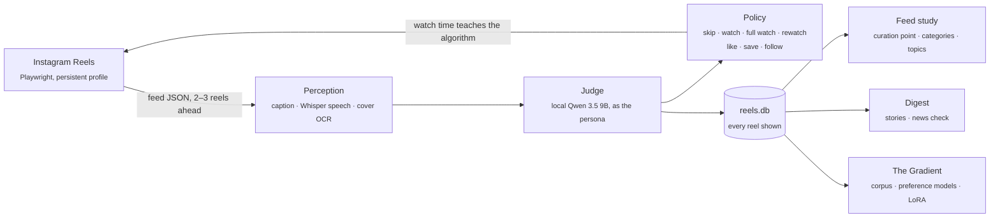

<div align="center">

<a href="docs/media/prag-brag.mp4"></a>

# PRAG_ML

### Parametric Reel Aggregation & Gradient

*Give an Instagram account a persona. Let it scroll the way that person would until the algorithm believes it.<br>
Then study what the algorithm feeds someone like them, and train models on nothing but that feed.*

<br>


[Overview](#overview) ·
[Architecture](#architecture) ·
[The Gradient](#the-gradient-machine-learning) ·
[Results](#results) ·
[Getting started](#getting-started) ·
[Usage](#usage) ·
[Project layout](#project-layout) ·
[Limitations](#limitations-and-responsible-use)

</div>

---

## Table of contents

1. [Overview](#overview)
2. [Key features](#key-features)
3. [Architecture](#architecture)
4. [The Gradient: machine learning](#the-gradient-machine-learning)
5. [Results](#results)
6. [Getting started](#getting-started)
7. [Usage](#usage)
8. [The control panel](#the-control-panel)
9. [Project layout](#project-layout)
10. [Testing](#testing)
11. [Documentation](#documentation)
12. [Limitations and responsible use](#limitations-and-responsible-use)
13. [Roadmap](#roadmap)
14. [License](#license)

---

## Overview

Every feed is a reply. Instagram watches what you linger on and serves more of it. PRAG asks the reverse
question: **what does the algorithm serve a particular kind of person, and what would a mind fed only on that
believe?**

You describe a person, for example a right-leaning civil engineer in Indore or a left-leaning teacher in Pune. PRAG
takes a dedicated account and **scrolls Reels as that person would**. It watches to the end what they would watch,
flicks past what they would skip in under two seconds, and likes, saves and follows the way they would. Watch time
is the strongest signal the Reels ranker listens to, so the feed bends. Once it has bent far enough, PRAG marks the
account as **curated**, and every reel shown after that is a sample of what the algorithm pushes to someone like
that person.

The project has two halves:

| Half | What it does |
|---|---|
| **Collection** (the agent) | Autonomous, persona-driven Reels sessions: multimodal perception, LLM judging, a bandit-style engagement policy, and a SQLite log of every reel shown. |
| **The Gradient** (the ML) | Models trained only on what each persona's feed served: per-persona preference classifiers, a "whose feed is it?" classifier, and LoRA persona language models that chat, debate and cite their own feed. |

> Reels often carry news before anywhere else, or news that never reaches the papers at all. PRAG records all of
> it, so later phases can ask which of it was true.

## Key features

- **Persona-driven scrolling.** Each account carries a full persona: who the person is, what they watch to the end,
  what they scroll past, and the pages they would follow first. Presets ship with the project and can be edited in
  the panel.
- **Lookahead perception.** The feed's own JSON arrives two or three reels before they appear on screen, so a reel
  is often scored before it is visible.
- **Multimodal understanding.** MLX Whisper (large-v3-turbo) transcribes Hindi, Hinglish and English speech. EasyOCR
  reads the headline burned into the cover. The caption and metadata fill in the rest.
- **A local LLM judge.** Qwen 3.5 9B, served by LM Studio, returns structured JSON: topic, summary, whether the reel
  is informational, reasoning, and a value score from the persona's point of view. An external judge, Jev, is wired
  in as an option.
- **A bandit-style engagement policy.** Scores become a 25× gap in dwell time between a flick and a rewatch, with
  human-paced, capped likes, saves and follows, and ε = 0.10 exploration so the feed doesn't collapse.
- **The curation point.** The first window of 100 judged reels in which at least half fit the persona.
- **Feed study.** 16 content categories, multilingual topic clustering, feed narrowness (the effective number of
  topics), day-to-day drift, rising topics and cross-persona similarity.
- **The Gradient.** Preference models, LoRA persona models, retrieval-augmented chat and debate with checked
  citations, and versioned retraining on a frozen evaluation set.
- **Local first.** Collection, perception, judging, training and inference all run on the Mac. Remote calls (Jev,
  news feeds, writing reels) are explicit and optional.

## Architecture



| Stage | What happens |
|---|---|
| **See ahead** | Playwright intercepts the feed's API responses, so scoring starts before the reel is on screen. |
| **Perceive** | Whisper transcribes the speech, re-transcribing with a Hindi hint when detection lands elsewhere. OCR reads the cover, and the visual descriptors of the cover are measured locally. |
| **Judge** | The LLM scores *how likely this person is to watch to the end and engage*, judged by their views, not by whether the reel is accurate. |
| **Act** | The policy turns the score into SKIP, WATCH, FULL_WATCH or REWATCH, plus probabilistic likes, saves and follows under per-session caps (20 / 5 / 3). |
| **Record** | Every reel shown lands in SQLite with everything known about it, whether it was watched or skipped. |
| **Study** | Curation verdict, categories, topics, story grouping, news verification and a daily HTML digest. |

## The Gradient: machine learning

The ML half learns from what each persona's feed served it, and nothing else. The full rationale, including why
these models were chosen over the alternatives, is in [docs/TRAINING.md](docs/TRAINING.md).

| Model | What it is | What it learns |
|---|---|---|
| **Preference model** (one per persona) | TF-IDF (word 1–2 and character 2–5 grams) or multilingual embeddings, followed by logistic regression | Will this persona watch the reel to the end and engage? |
| **Whose-feed model** (shared) | The same family of classifiers | Which persona's feed a reel came from |
| **Persona language model** (one per persona) | A rank-16 LoRA adapter on frozen Qwen3 4B Instruct (4-bit, MLX) | To answer as this persona, about what its feed showed it, with citations |

**The corpus.** 44,507 unique items in English, Hindi and Hinglish: reels from the Instagram sessions, about 31,000
reels written for each feed by an LLM following the persona's profile (many of them about real news stories from the
past two weeks, each linked to its article), RSS news headlines and Wikipedia. Every item records where it came
from.

**Rigour.**

- **Splits are grouped by story**, so retellings of the same story never land on both sides of the split.
- **Hyperparameters and thresholds are chosen on validation**, and the test set is only ever scored.
- **Each persona's first run freezes its evaluation set**, so every later version is compared on the same items.
- **Leakage is controlled.** Creator handles and persona cities are scrubbed from the text, and provenance and
  teacher scores never reach the features.

**At answer time** the system uses retrieval-augmented generation restricted to the persona's own feed:

```
question ─▶ embed ─▶ search this persona's feed only ─▶ rank: similarity + 0.15 × p(persona engages)
                                                                │
                         persona LoRA model ◀── top reels, numbered, as evidence
                                │
                                ▼
                 answer ─▶ citations checked against what was retrieved
```

**Analyses** available from the panel's *Ask* tab:

- **Chat** with a persona.
- **Debate** between both personas on a topic you choose, with a neutral moderator.
- **Framing:** one question, two worldviews.
- **Blind spots:** reels from the side a feed leans away from, and how far the persona's answer moves when it sees
  them.
- **Echo chambers:** how far apart the two feeds grow, day by day.
- **Engagement predictor:** whether each persona would watch a reel, and the words that decided it.

## Results

All numbers are measured and regenerated by `python -m gradient.report`. The full tables, including per-slice
breakdowns and version history, are in [docs/results/gradient.md](docs/results/gradient.md).

### Preference models (frozen test set)

| Model | @mlproject01 · test PR-AUC | @mlproject02 · test PR-AUC |
|---|---|---|
| Majority class | 0.448 | 0.507 |
| Quick rules (watch / skip words) | 0.616 | 0.625 |
| Multilingual embeddings + LR | 0.841 | 0.874 |
| **TF-IDF + LR (chosen)** | **0.926** | **0.944** |

The chosen models reach F1 0.839 and 0.864. On the small slice of real Instagram reels in each test set (59
items), PR-AUC is 0.64 and 0.90. Treat those two figures as a first check, not a verdict. The shared whose-feed
classifier reaches a test PR-AUC of 0.771.

### Persona language models (held-out perplexity, lower is better)

| Adapter | @mlproject01 | @mlproject02 |
|---|---|---|
| Base Qwen3 4B | 80.53 | 130.63 |
| **lora-v3 on its own persona** (active) | **5.14** | **5.20** |
| lora-v3 on the *other* persona | 5.80 | 5.77 |

Each adapter fits its own persona better than the other persona, which shows it learned the persona and not just
the answer format. lora-v4 is kept on record but is not active, because it forgot more than it gained. The
reasoning is in [docs/TRAINING.md](docs/TRAINING.md#3-training-again-and-again-as-the-data-grows).

### Simulated sessions

The simulation covers 14 days and 224 sessions, with about 17,000 impressions from a recommender that learns only
from the persona's behaviour. Over that time, the share of reels that fit each persona rose from **75% → 87%**
(@mlproject01) and **72% → 88%** (@mlproject02). The simulation lives in its own database and is always labelled
*Simulated* in the panel.

## Getting started

### Prerequisites

| Requirement | Notes |
|---|---|
| macOS on Apple Silicon | MLX (Whisper and LoRA) requires it. Developed on 24 GB of unified memory. |
| Python 3.14 | |
| [ffmpeg](https://ffmpeg.org/) | `brew install ffmpeg`. Whisper uses it to decode audio. |
| [LM Studio](https://lmstudio.ai/) | Serving `qwen/qwen3.5-9b` (`LLM_MODEL_NAME` in `config.py`). `main.py` can start it through the `lms` CLI. |
| Dedicated Instagram accounts | **Never use a personal account.** In live runs the agent likes, saves and follows. |

### Installation

```bash
git clone https://github.com/kidraah/PRAG_ML.git
cd PRAG_ML

python3 -m venv .venv
source .venv/bin/activate
pip install -r requirements.txt
playwright install chromium
```

### Configuration

1. **Accounts.** Create `accounts.json` in the project root. Only a username is required. If you leave out the
   password, you log in by hand in the browser window on the first run, and the browser profile keeps the login:

   ```json
   [{ "username": "my_research_account" }]
   ```

   Then seed the database:

   ```bash
   python -m database.seed
   ```

2. **API keys (optional).** Create a `.env` file in the project root. You only need it if you use the remote judge
   Jev, which goes through OpenRouter, or the LLM reel writer:

   ```dotenv
   OPENROUTER_API_KEY=your-key-here
   ```

3. **Tuning.** Thresholds, dwell bounds, engagement caps, the scorer (`SCORER`), Jev vision (`JEV_VISION`) and the
   curation window all live in [`config.py`](config.py).

> `accounts.json`, `.env`, `reels.db`, browser profiles, logs, personas, datasets and models are all git-ignored and
> stay on your machine.

## Usage

### Collection

```bash
python launch.py                        # open the local control panel
python launch.py --presentation         # the panel with collection disabled (stored data and local models only)
python main.py --account NAME           # one session
python main.py --account NAME --dry-run # watch time only, never like, save or follow
python daily.py --account NAME          # a guarded daily run, then the digest (what the schedule runs)
python -m dashboard.feed --all          # every persona's feed, in the terminal
python -m ml.feed_model --train         # relearn the feed's topics
```

### The Gradient

```bash
python -m gradient build                # first time: corpus, labels, headlines and models
python -m gradient update [--lora]      # new data → labels → retrain (and continue the LoRA adapters)
python -m gradient status               # what's in the corpus, per persona
python -m gradient.report               # regenerate docs/results/gradient.md

python -m gradient chat --account mlproject02 "What's going on with air pollution?"
python -m gradient debate --topic "The Agniveer scheme"
python -m gradient compare "Is the government handling unemployment well?"

python -m gradient.simulate [--append]  # 14 days of simulated sessions, in their own database
python -m gradient.lora --account mlproject01 --activate 3   # pick the adapter chat uses (0 = newest)
```

## The control panel

`python launch.py` opens a local web panel, served to this Mac only with a per-launch token. It comes in two themes:
black and white, or *Brutal*.

<p align="center"></p>

| Tabs | Purpose |
|---|---|
| **Run** | Start a session (live, dry run or mixed), follow every reel as it is judged, and replay past sessions. |
| **Feed · Digest · Report** | The feed study, the daily story digest, and the curation verdict. |
| **Persona** | Write each account's persona or start from an editable preset, including its structured profile. |
| **Label** | A blind head-to-head: you judge reels as the persona, and the scorers' answers stay hidden until you finish. |
| **Corpus · Training · Ask** | The Gradient: what each feed is made of, every model version and its metrics, and chat, debate and analyses. |
| **Schedule · Accounts** | Daily runs through `launchd`, and account management. Passwords stay in a local file only you can read. |

**Hands off.** While a session runs, the browser ignores clicks, scrolls and keystrokes that don't come from the
agent. Anything that slips through anyway is caught and the session is marked as interrupted, so it never counts as
the persona's behaviour.

<p align="center"></p>

## Project layout

```
PRAG_ML/
├── agent/          personas and presets, engagement policy (bandit), creator memory, quick rules
├── automation/     Playwright driver with input lock, feed capture, login, prompts, notifications
├── perception/     Whisper, cover OCR, visual descriptors, the local LLM judge, categories, Jev
├── stories/        story grouping, news verification, the daily digest
├── dashboard/      the curation report and the feed study
├── ml/             the original preference model and the feed topic model
├── gradient/       corpus, reel writer, news, labels, preference models, LoRA, retrieval, chat, debate, simulation
├── database/       SQLite schema, accounts, seeding
├── tools/          follow-first, review, schedule, the Jev / LLM head-to-head
├── tests/          unit and integration tests (unittest)
├── docs/           training notes, presentation guide, measured results, media
├── config.py       every tunable in one place
├── launch.py       the control panel
├── main.py         a single session
└── daily.py        a guarded daily run and digest
```

## Testing

The suite uses the standard library's `unittest` and needs no network access:

```bash
HF_HUB_OFFLINE=1 python -m unittest discover -s tests -t .
```

```
Ran 278 tests in 41.2s

OK
```

## Documentation

| Document | Contents |
|---|---|
| [docs/TRAINING.md](docs/TRAINING.md) | How the Gradient is trained, the data, leakage control, and why each modelling choice was made |
| [docs/results/gradient.md](docs/results/gradient.md) | Every measured number: corpus, per-slice metrics, confusion matrices, version history, perplexities |
| [docs/PRESENTING.md](docs/PRESENTING.md) | A ten-minute walkthrough of the project for a live demo |

## Limitations and responsible use

- **The labels are a model's judgement.** The preference models predict *Jev's* judgement of each persona, not a
  real person's. The Label tab provides a blind human check.
- **Written reels are not Instagram posts.** Reels written for a feed are realistic text, and the corpus records the
  source of every item. Results are also reported per source.
- **The personas are fictional individuals.** They don't stand in for everyone who shares their politics.
- **Grounding is not truth.** Citation checks and abstention training improve grounding, but they can't guarantee a
  model never says something unsupported. A persona believing something doesn't make it true.
- **Terms of service.** Automating an account may break Instagram's terms. Run PRAG only on accounts created for
  research, at human-plausible rates. Engagement is capped per session for exactly this reason.

## Roadmap

- [x] Persona mode, the curation point, categories, the feed study and dataset export
- [x] The feed model: shared topics, narrowness, drift, and what sets each persona apart
- [x] Accounts, personas and presets, all managed from the panel
- [x] The input lock, so nobody at the Mac can steer a persona by accident
- [x] **The Gradient:** per-persona preference models, LoRA persona models, chat, debate and analyses
- [x] Jev sees cover images (behind `JEV_VISION`)
- [ ] **Faster judging.** In a blind head-to-head, Jev matched the labels on 35 of 39 reels and the local LLM on 34,
      at 0.37 s against 7.8 s per reel. Jev is wired in but switched off (`SCORER` in `config.py`).
- [ ] **More real feed and more human labels**, so the real share of the corpus grows with every `gradient update`
- [ ] **Real or not:** follow stories that appeared only on Reels, to see which ones reach the news and how early

## License

No open-source licence has been granted yet, so all rights are reserved by the author. Please contact the author
before reusing the code.

---

<div align="center"><sub>Built by <b>KIDRAAH_</b> · A research tool for studying recommendation algorithms.</sub></div>
