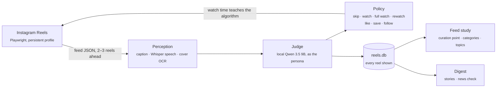
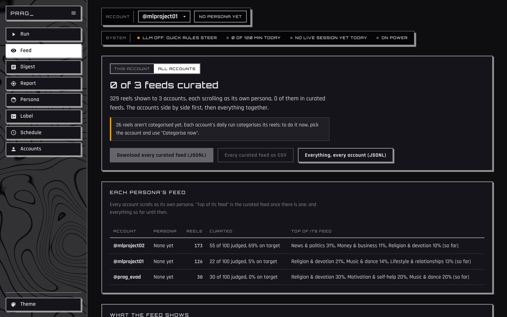
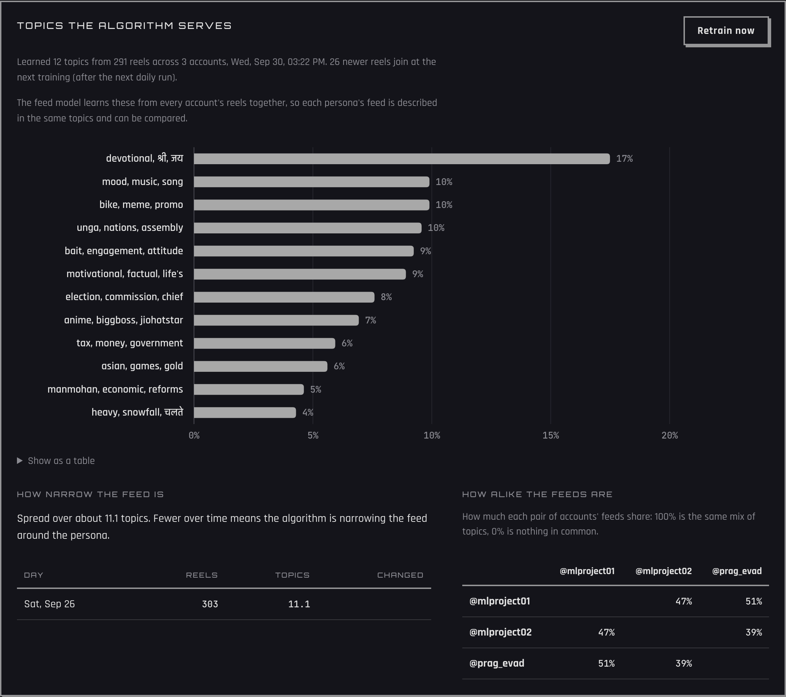
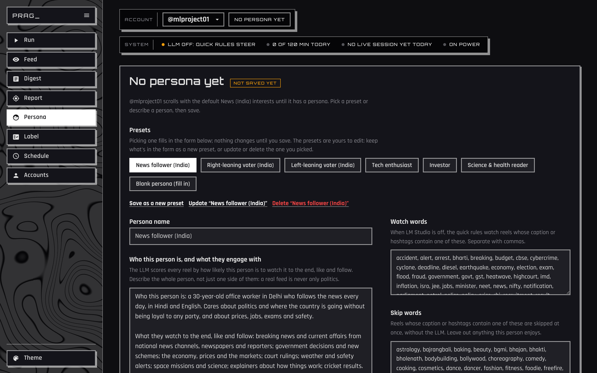

<div align="center">

<a href="docs/media/prag-brag.mp4"></a>

# PRAG_

**Parametric Reel Aggregation & Gradient**

*Give an Instagram account a persona. Let it scroll like that person until the algorithm believes it.<br>Then study exactly what the algorithm feeds someone like them.*


[Watch the 25-second video](docs/media/prag-brag.mp4) · [How it works](#how-it-works) · [Run it](#run-it) · [The study](#the-study) · [The Gradient](#the-gradient-per-persona-models-chat-and-debate)

</div>

---

## What PRAG is

Every feed is a reply. Instagram watches what you linger on and answers with more of it. PRAG asks the question the other way round: **what does the algorithm serve a particular kind of person?**

You describe a person: a 38-year-old shop owner in Lucknow who backs the BJP, a postgraduate in Kolkata who votes opposition, a Delhi office worker who lives on the news. PRAG takes a dedicated account and **scrolls Reels as that person would**. It watches what they'd watch to the end, flicks past what they'd skip in under two seconds, and likes, saves and follows the way they would. Watch time is the loudest signal Instagram listens to, so the feed bends. When it has bent far enough, PRAG calls it **curated**. From then on, every reel it's shown is a sample of what the algorithm pushes to someone like that.

The result is a labelled, persona-by-persona dataset of **what the feed serves**: every reel, its words, its creator, its topic, when it was shown, and how the persona reacted. That dataset is the raw material for the "Gradient": the models that learn what each persona is fed.

> Reels often carry news before anywhere else, or news that never reaches the papers at all. PRAG records it all, and later phases ask which of it was true.

## How it works



| Stage | What happens |
|---|---|
| **See ahead** | The feed's own JSON arrives before the reel is on screen, so scoring starts early. |
| **Perceive** | MLX Whisper transcribes the speech (Hindi, Hinglish, English); EasyOCR reads the headline burned into the cover. |
| **Judge** | The local LLM scores *how likely this person is to watch it to the end and engage*, judged by their views, not by whether it's accurate. |
| **Act** | A bandit-style policy turns the score into dwell time, a 25× gap between a flick and a rewatch, with human-paced likes, saves and follows, and 10% exploration so the feed never collapses into one note. |
| **Record** | Every reel shown lands in SQLite with everything known about it, whether watched or skipped. |
| **Study** | The feed study finds when each account became curated, sorts reels into 16 categories, and the feed model learns the topics across all accounts. |

## The study

<p align="center"></p>

- **Personas, not keywords.** Each account has its own persona: who the person is, what they watch to the end, what they scroll past, the pages they'd follow first. Seven editable presets ship with it, including evenly written right- and left-leaning voters, so a feed is never a caricature of one interest.
- **The curation point.** The first window of 100 judged reels where at least half fit the persona. Everything before it is the warm-up; everything after is the curated feed you study and train on.
- **One account or all of them.** The Feed tab shows each persona's content mix before and after curation, the creators the algorithm keeps serving, and every reel shown. Switch to *All accounts* to put the personas side by side.
- **The feed model.** It learns topics from every account's reels together, using multilingual embeddings clustered into named topics, so all personas are described in the same terms. It tracks how narrow each feed gets (the effective number of topics), how much it shifts day to day, what's rising, what sets a persona apart, and how alike the feeds are.
- **The dataset.** One click exports the curated feed, or everything, as JSONL or CSV, with each reel's account, persona, phase and category.

<p align="center"></p>

## The Gradient: per-persona models, chat and debate

The ML half of PRAG: models that learn from what each persona's feed served it, and nothing else. How it's trained,
and why this way rather than another, is in [docs/TRAINING.md](docs/TRAINING.md). Every measured number is in
[docs/results/gradient.md](docs/results/gradient.md), written by `python -m gradient.report`.

- **Two personas.** @mlproject01 is a right-leaning civil engineer in Indore: national security, infrastructure and
  government schemes, plus cricket, gadgets, Hindi comedy and street food. @mlproject02 is a left-leaning teacher in
  Pune: labour, public services, civil liberties and the environment, plus football, indie music, photography and
  gaming. Each persona has a readable description and a structured profile (topic weights, stance and language
  preferences), both editable in the Persona tab.
- **The training corpus.** About 44,500 unique items in English, Hindi and Hinglish. They are the reels the Instagram
  sessions recorded, about 31,000 reels written for the two feeds by an LLM following each persona's profile (about
  18,000 of them about real news stories from the last two weeks, picked for each persona by its own preference
  model and linked to their articles), news headlines and Wikipedia. Every item records where it came from. Jev judges every item for both personas, and each persona
  has its own reaction, in its own words, to every reel in its feed.
- **Preference models, one per persona.** A majority baseline, the quick rules, TF-IDF + logistic regression and
  multilingual embeddings + logistic regression, all on the same story-grouped splits. The best model and its
  threshold are chosen on validation and scored once on a frozen test set. Test PR-AUC is about 0.92 for each
  persona, against about 0.6 for the hand-written rules, and 0.70 / 0.90 on the 59 real Instagram reels
  in each test set (a small, noisy slice).
- **Persona language models.** A LoRA adapter per persona on Qwen3 4B (4-bit, MLX), trained on its feed, its
  reactions, and about 3,000 written answers and debate turns that interpret its reels and cite them. It runs
  entirely on the Mac.
- **Simulated sessions.** Set Data to Simulated in the panel for 14 days of *simulated* sessions for both personas
  (`python -m gradient.simulate`, then `--append` to add more around the existing ones without touching them):
  about 17,000 impressions from a recommender that learns from the persona's behaviour, the real engagement policy,
  timestamped logs you can replay, the feed day by day (paged, with a reel inspector), and daily digests, all under a
  "Simulated sessions" banner and in their own database. Each session keeps the time it was really generated and
  the batch that made it. Live shows only the real sessions.
- **Ask.** *Chat* with a persona, run a *debate* between both on a topic of your choice (with a neutral moderator),
  or use one of four analyses: *framing* (one question, two worldviews, and the words each feed uses for the topic),
  *blind spots* (show a persona reels from the side its feed leans away from and measure how its answer moves),
  *echo chambers* (how far apart the two feeds grow, day by day) and the *engagement predictor* (whether each
  persona would watch a reel, and the words that decided it). Answers retrieve only from the persona's own feed,
  ranked by its preference model; the persona interprets the reels in its own voice (a draft that copies their
  wording is rewritten), and every citation is checked.
- **Grows over time.** `python -m gradient update` takes in new session reels, labels them, retrains, and compares
  every version on the same frozen evaluation set. `--lora` continues each adapter from the last one.
- **Jev can see covers.** Jev 1.13 and 1.14 accept images (TypeSafe, 14 October 2026). With `JEV_VISION` on (it's
  off by default: it costs more and sends the images off the Mac), each reel's cover goes to Jev as an inline JPEG
  through OpenRouter's Decisions API, in the same request as the caption, transcript, on-screen text and audio
  metadata, prepared to Jev's size limits. If the image is rejected, the call is repeated with text only and the
  reason is recorded. Every downloaded cover is also measured locally (`perception/visual.py`: brightness,
  contrast, colourfulness, how busy it is, its palette); the descriptors are stored with the reel, shown in the
  session log and the Feed tab's reel inspector. One frame per reel, the cover: not the video.

```bash
python launch.py --presentation                 # the panel with collection disabled (stored data, local models)
python -m gradient status                       # the corpus, per persona
python -m gradient update [--lora]              # new data → labels → retrain
python -m gradient chat --account mlproject02 "What's going on with air pollution?"
python -m gradient debate --topic "The Agniveer scheme"
python -m gradient compare "Is the government handling unemployment well?"
```

## The control panel

`python launch.py` opens a local panel. It's served to this Mac only, with a per-launch token, and runs in two themes: black and white, or *Brutal*.

<p align="center"></p>

- **Run:** start a session (live, dry run, or mixed), follow every reel as it's judged, and stop it cleanly.
- **Feed, Digest, Report:** the study, the daily story digest, and the curation verdict.
- **Persona:** write each account's persona, or start from a preset you can edit.
- **Label:** a blind head-to-head. You judge reels as a persona; the scorers' answers stay hidden until you've finished.
- **Corpus, Training, Ask:** the Gradient: what each feed is made of, every model version with its metrics (and buttons to retrain), and chat, debate, one question two worldviews and the feed predictor.
- **Schedule, Accounts:** daily runs through launchd, and adding, editing or removing accounts. Passwords stay in a local file only you can read.
- **Hands off:** while a session runs, the browser window ignores clicks, scrolls and keys that don't come from the agent. Anything that slips through anyway is caught and marked as interrupted, so it never counts as the persona's behaviour.

## Run it

```bash
# macOS on Apple Silicon, Python 3.14, ffmpeg, LM Studio serving qwen/qwen3.5-9b
python -m venv .venv && source .venv/bin/activate
pip install -r requirements.txt && playwright install chromium

python -m database.seed          # accounts from accounts.json
python launch.py                 # the control panel
python daily.py --account NAME   # one session, then the digest (what the schedule runs)
python -m dashboard.feed --all   # every persona's feed, in the terminal
python -m ml.feed_model --train  # relearn the feed's topics
python -m gradient update        # grow the corpus and retrain the persona models
```

`accounts.json`, `.env`, the database, browser profiles, logs, personas and models are git-ignored. **Use accounts made for PRAG, never your own**: in live runs the agent likes, saves and follows.

## Under the hood

```
agent/        personas and presets, the engagement policy, creator memory, quick rules
automation/   Playwright driver (input lock included), feed capture, login, prompts
perception/   Whisper, cover OCR, the local LLM judge, categories, Jev (under evaluation)
stories/      story grouping, news check, the daily digest
dashboard/    the curation report and the feed study
ml/           the preference model and the feed model
gradient/     the Gradient: corpus, reel writer, Jev labels, preference models, LoRA, retrieval, chat, debate, panel tabs
tools/        follow-first, review, schedule, the Jev / LLM head-to-head
launch.py     the control panel      daily.py   a guarded daily run      main.py   one session
```

## Where it's going

- [x] Persona mode, the curation point, categories, the feed study and dataset export
- [x] The feed model: shared topics, narrowness, drift, what sets each persona apart
- [x] Accounts, personas and presets, all managed from the panel
- [x] The input lock: nobody at the Mac can steer a persona by accident
- [x] **The Gradient.** Per-persona preference models and LoRA persona models, retrained as the corpus grows; chat, debate, two worldviews and the feed predictor
- [x] **Jev sees cover images** (Jev 1.13 / 1.14 via OpenRouter's Decisions API), behind `JEV_VISION`
- [ ] **Faster judging.** A blind head-to-head on a right-leaning persona: Jev (TypeSafe, via OpenRouter) matched the labels on 35 of 39 reels and the local LLM on 34, and Jev answered in 0.37 s against 7.8 s. The plan is for Jev to decide in time while the local LLM keeps writing every reel's topic and summary. It's in the code, switched off (`SCORER` in `config.py`); 
- [ ] **More real feed, more human labels.** Every scheduled session adds to the corpus; blind human reviews in the Label tab measure how well Jev stands in for a person.
- [ ] **Real or not.** Following "only on Reels" stories over the next days: which reached the news, how early Reels had them, and which never did.

---

<div align="center"><sub>Built by <b>KIDRAAH_</b>. A research tool for studying recommendation algorithms. Automating an account may break Instagram's terms; run it only on accounts made for the purpose.</sub></div>
